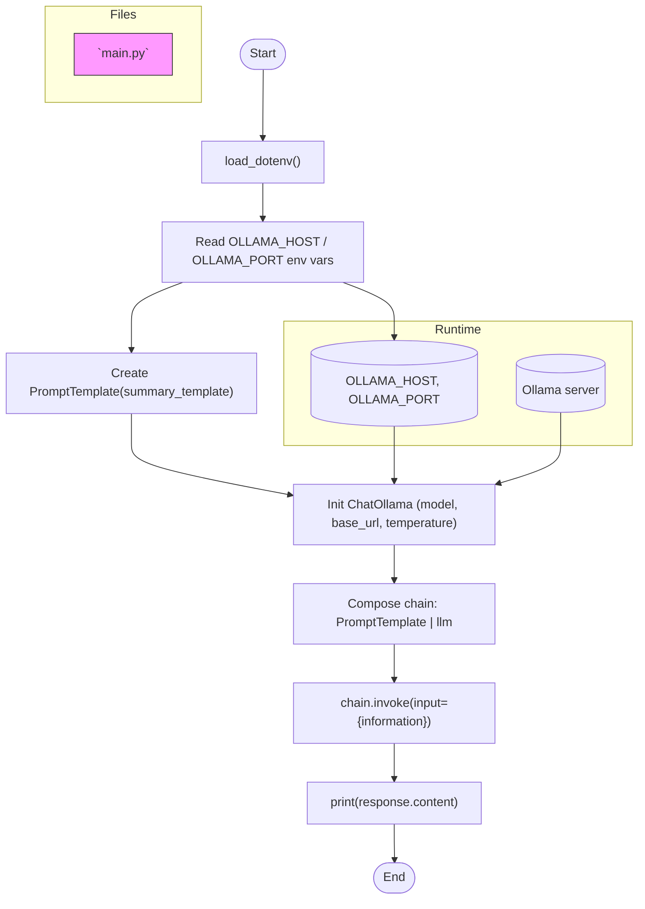

# llangchain-tutorial

Short demo showing a small LangChain + Ollama usage pattern. The included `main.py`:

- loads environment variables (OLLAMA_HOST, OLLAMA_PORT)
- builds a PromptTemplate
- initializes a ChatOllama LLM client
- composes a simple chain (PromptTemplate | LLM)
- invokes the chain and prints the response

Prompt file
- The prompt template used by `main.py` has been extracted to `prompts/summary_template.txt` for easier editing and reuse.

## What is an "AI Message"

AI Message
A compact object that represents one message in a conversation with an AI assistant. It records who sent the message (user, system, or assistant), the text content, and optional metadata (timestamp, channel, or tags). Think of it like a single chat bubble that your app can send, store, and replay — easy to serialize (JSON), filter, and inspect.

Why it matters
- Keeps conversation history consistent and machine-friendly so the AI and your app always agree on who said what.
- Enables simple features like logging, moderation, role-based prompts, and replaying conversations for debugging.

Relatable example
- Like sending a text: you type a message (user), the assistant replies (assistant), and the app saves each chat bubble with who sent it and when.

## Components and control flow (from `main.py`)

The diagram below shows the main components and control flow used in `main.py`.



## How to run

1. Ensure you have Python 3.10+ and a virtual environment.

2. Install dependencies (example — adjust package names to match your environment):

```bash
python -m venv .venv
source .venv/bin/activate
pip install python-dotenv langchain-ollama langchain-core
```

3. Create a `.env` file with your Ollama server settings:

```bash
echo "OLLAMA_HOST=localhost" > .env
echo "OLLAMA_PORT=11434" >> .env
```

4. Run the example:

```bash
source .venv/bin/activate
python main.py
```

Notes
- If your dependency package names differ (project uses `langchain_ollama`, etc.), install the packages you use in your environment. The example above shows commonly used names but may need to be adjusted.
- The Mermaid diagram can be rendered by GitHub or other Markdown viewers that support Mermaid.

About LangChain
- LangChain is a framework for building applications with LLMs. It provides abstractions like prompts, chains, agents, and memory so you can compose LLM calls and logic in a structured way.

About Ollama
- Ollama is a local LLM server/runtime that hosts models and exposes an HTTP API. In this project we use `ChatOllama` to talk to an Ollama server running on the host defined by `OLLAMA_HOST`/`OLLAMA_PORT`.

---

If you'd like, I can also add a minimal `requirements.txt` or pin exact package names and versions.
